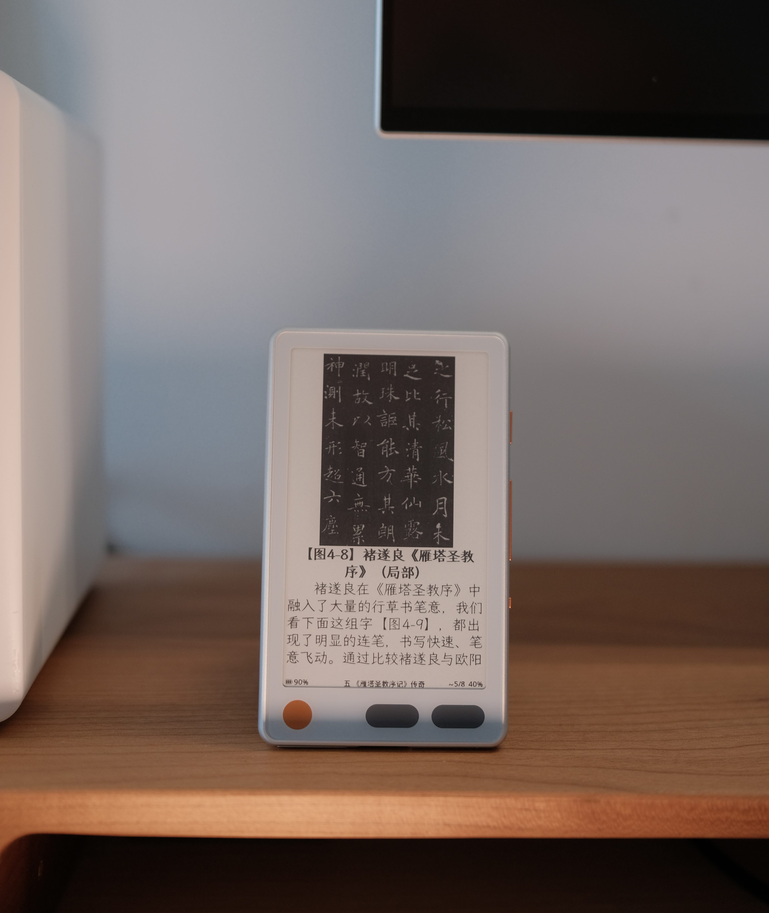

# CrossMux

**English** | [简体中文](./README.zh-CN.md)

**CrossMux** is a community fork of [CrossPoint Reader](https://github.com/crosspoint-reader/crosspoint-reader) for ESP32 e-ink devices. Reading comes first, with lightweight apps, reading analytics, standby faces, and on-demand services alongside the reader.

[Releases](https://github.com/0x1abin/crossmux/releases) · [User guide](./USER_GUIDE.md) · [Contributing](./docs/contributing/README.md)



## Features

- **Reading and library**: EPUB, TXT, XTC/XTCH and images; chapter navigation, bookmarks, dictionaries, custom fonts, reading backgrounds, and KOReader progress sync.
- **Wireless workflows**: browser file transfer and settings, Calibre wireless, OPDS downloads, WebDAV, and device OTA updates.
- **Apps**: lightweight games and tools including Sudoku, Gomoku, Chinese Chess, Minesweeper, 2048, Electronic Woodfish, and Ugly Avatar. [Apps guide](./src/activities/apps/README.md).
- **AirPage**: scan to upload content, then display BMP/JPEG images with manual refresh or foreground live delivery; images can become a sleep screen. [Usage and network behavior](./src/activities/apps/README.md#airpage).
- **WeRead**: QR login, bookshelf browsing, EPUB downloads for offline reading, and progress sync. Available in the China content profile. [WeRead guide (Chinese)](./src/activities/apps/weread/README.md).
- **Reading analytics and standby**: reading statistics, heatmaps, profiles and achievements; clock and Chinese almanac faces. [Analytics guide](./src/activities/apps/reading-stats/README.md).
- **Languages and development**: All UI languages in one firmware per hardware target, plus desktop simulators for UI development.

> **WeRead security:** this unofficial Web protocol may change. Device traffic is encrypted, but its client does not verify the server certificate or hostname; use it only on a trusted network. The native simulator verifies certificates through the host trust store. See the [transport details](./docs/engineering/chinese-build.md#weread-transport).

## Devices and release channels

| Device | Chip | Configured channels |
|---|---|---|
| Xteink X3 / X4 (shared image) | ESP32-C3 | Stable, Nightly |
| [Seeed Sticky](https://www.seeedstudio.com/sticky/?utm_source=partner&utm_medium=crossmux&utm_campaign=readme) | ESP32-S3 | Stable, Nightly |
| Xteink X4 Pro | ESP32-S3 | Stable, Nightly |
| M5Stack Paper Mono | ESP32-S3 | Stable, Nightly |
| eego A4 | ESP32-S3 | Stable, Nightly |
| Murphy M4 | ESP32-S3 | Stable, Nightly |
| Waveshare ePaper 3.97 | ESP32-S3 | Stable, Nightly |
| [Metalio E-Ink 4](./docs/engineering/metalio-eink4.md) | ESP32-S3 | Stable, Nightly |
| [Read Pico (小纸 Pico)](./docs/engineering/read-pico.md) | ESP32-S3 | Stable, Nightly |

All nine targets are configured for both channels. Availability depends on a successful publication in the selected regional catalog; newly enabled Stable packages arrive with the next formal release after the pipeline rollout. This configuration does not establish hardware acceptance. Each S3 target needs its own image. X4 Classic (`x4c`) and [LilyGo T5 S3 4.7 PRO/Lite](./docs/engineering/lilygo-t5s3.md) (`lilygo_t5s3`) remain development-only. See [device variants](./docs/engineering/device-variants.md) for target-specific limitations.

Use [Stable](https://github.com/0x1abin/crossmux/releases/tag/stable) for formal releases, or [Nightly](https://github.com/0x1abin/crossmux/releases/tag/nightly) for development builds. Both channels use the same target and package rules. The [target table](./scripts/nightly_targets.py) defines channels and artifact names; [release architecture](./docs/engineering/firmware-release.md) explains packaging and OTA. Current source version and build environments live in [platformio.ini](./platformio.ini).

## Install firmware

1. Open the [global Web tool](https://crossmux.com) or [China Web tool](https://crossmux.cn), enter the firmware flasher, and choose your exact device and an available Stable or Nightly version. The deployed tool discovers options from its regional release catalog. X3/X4 share an image; S3 images are board-specific.
2. Back up your SD card data before changing firmware, and retain a complete Flash backup when the device's first-install or recovery instructions require one. Follow the matching [device documentation](./docs/engineering/device-variants.md) and the tool's confirmations.
3. For offline installation, use [CrossMux Releases](https://github.com/0x1abin/crossmux/releases). After the new pipeline rollout, both channels publish `crossmux-<version>-<deviceSlug>.zip` with all installation segments, manifests and SHA-256 checksums. An application-only `firmware.bin` is not a complete first-install image. Historical releases retain their existing assets and instructions.

To build from source, use the [development commands](#development-quick-start) below. For an existing CrossMux installation, device OTA selects an available release by model, content profile and channel.

X4 Pro packages use slug `x4pro`; Metalio E-Ink 4 packages use `metalio-eink4` and model/board tag `metalio_eink4`. Both language entries point to the same multilingual firmware per device. The Web tool offers a channel only when its catalog contains a matching package. Follow the [Metalio guide](./docs/engineering/metalio-eink4.md) for first installation, wiring and hardware validation status.

### USB-locked Xteink devices

Some devices may restrict USB flashing. The [upstream Xteink Unlocker](https://crosspointreader.com/#unlock-tool) is a separate tool; consult its current compatibility and recovery instructions before use. CrossMux compatibility with a locked device must not be inferred from CrossPoint compatibility. Flashing unsupported firmware may leave the device without a recovery path. If the serial device is missing, also check the data cable, port, and browser permissions.

## Chinese fonts and content profiles

Every hardware target builds one language-unified firmware. Simplified Chinese selects the China content profile (`crossmux.cn`); other UI languages select Global (`crossmux.com`). Changing the UI language updates the profile and regional apps, including WeRead and Chinese Chess.

The UI includes compact 8/10/12pt Simplified-Chinese fallback fonts. Built-in reader font choices share a 12pt offline fallback; complete families, other sizes, style variants, and broader Unicode coverage use SD-card `.cpfont` files. Embedded fonts are a subset, so rare or Traditional Chinese characters may require an appropriate SD font.

Download fonts from **Settings > Reader > Manage Fonts**, or copy converted fonts to the SD card. See [SD-card fonts](./docs/sd-card-fonts.md) for installation and conversion, and [Chinese support](./docs/engineering/chinese-build.md) for the embedded-font toolchain. Normal builds need no font regeneration.

## Development quick start

Install PlatformIO Core (`pio`) and Python 3; the repository pins its pioarduino platform. Full code checks also need clang-format 21+, CMake, and Ninja. See [Getting Started](./docs/contributing/getting-started.md) for setup.

```bash
git clone --recursive https://github.com/0x1abin/crossmux.git
cd crossmux

# If submodules were not initialized:
git submodule update --init --recursive

# X3/X4 development build
pio run -e default

# X3/X4 unified-language stable build
pio run -e gh_release

# Build and flash that image to a connected X3/X4
pio run -e gh_release -t upload
```

The application binary is `.pio/build/<environment>/firmware.bin`. The committed configuration has 35 build entries: Dev, Stable and Nightly for each of the nine release targets, two development-only boards and six simulators. Versions and Git hashes are generated automatically: Stable `<base>`, Nightly `<base>-rc+<sha7>`, Dev `<base>-dev-<branch>-<sha7>`. For other boards, see [build-system.md](./docs/engineering/build-system.md).

For X4 Pro and Metalio E-Ink 4:

```bash
# X4 Pro: Dev / Stable / Nightly
pio run -e x4pro
pio run -e x4pro-gh_release
pio run -e x4pro_nightly

# Metalio E-Ink 4: Dev / Stable / Nightly
pio run -e metalio_eink4
pio run -e metalio_eink4-gh_release
pio run -e metalio_eink4_nightly
```

The Stable ZIPs are `crossmux-<version>-x4pro.zip` and `crossmux-<version>-metalio-eink4.zip`. First installation also requires the matching bootloader and partition layout; use the complete installation package and the device guide.

For Read Pico (小纸 Pico):

The recursive checkout includes the pinned SDK drivers; see the [Read Pico guide](./docs/engineering/read-pico.md#current-implementation--2026-09-30) for implementation details.

```bash
pio run -e readpico
```

On Windows, set `PYTHONIOENCODING=utf-8` before running `pio`, otherwise the build can stall when PlatformIO prints the Arabic i18n language row.

The application is `.pio/build/readpico/firmware.bin`. First installation is a **full-table flash** — `bootloader@0x0`, `partitions@0x8000`, `boot_app0@0xe000`, `app@0x10000` — after a verified full-chip (16 MiB) backup, because the repository partition table and the board's factory `partitions_16M.csv` disagree at `0xE000` and use different app-slot sizes. Stable/Nightly configuration does not close physical acceptance. See the [Read Pico guide](./docs/engineering/read-pico.md) for the pin map, the frozen build flags and the pending acceptance checklist.

### Desktop simulator

Install SDL2 and curl (plus OpenSSL development headers on Linux), place EPUBs in `fs_/books/`, then run:

```bash
pio run -e simulator -t run_simulator           # X4
pio run -e simulator_x3 -t run_simulator        # X3
pio run -e simulator_eego_a4 -t run_simulator   # eego A4
pio run -e simulator_murphy_m4 -t run_simulator # Murphy M4
pio run -e simulator_readpico -t run_simulator  # Read Pico, 684x1216 portrait
```

The [CrossMux simulator fork](https://github.com/0x1abin/crosspoint-simulator) is pinned in `platformio.ini`. It previews UI and input flows; it does not validate display waveforms, power consumption, or physical hardware timing.

Read Pico fits its window to the desktop while retaining full-resolution BMP screenshots. Mouse input supports tap, hold and swipe; Up/Escape/Down represent the three capacitive keys, and only Power (`P`) wakes from sleep. Native sixteen-level images and SD UI fonts follow the Read Pico paths. See the [device guide](./docs/engineering/read-pico.md#desktop-simulator) for validation details.

### Checks and debugging

```bash
./bin/ci-check       # Full code-change checks; does not rewrite sources
pio device monitor  # Serial logs from a connected device
```

Use [Testing and Debugging](./docs/contributing/testing-debugging.md) for focused checks and the enhanced serial monitor. Documentation-only changes need link, command, and whitespace checks rather than firmware builds.

## Documentation and contributing

- [User guide](./USER_GUIDE.md) · [Web transfer](./docs/webserver.md) · [Web API](./docs/webserver-endpoints.md)
- [Project scope](./SCOPE.md) · [Governance](./GOVERNANCE.md) · [Contributor guide](./docs/contributing/README.md)
- [Agent instructions](./AGENTS.md) · [Engineering reference](./docs/engineering/index.md) · [Touch and UI](./docs/contributing/touch-and-ui.md)
- [Cache management](./docs/engineering/cache-management.md) · [File formats](./docs/file-formats.md)

Report bugs and propose changes in [CrossMux Issues](https://github.com/0x1abin/crossmux/issues). Contributions target **`0x1abin/crossmux:main`**; keep each PR focused and describe its verification. Existing CrossPoint class names and the `/.crosspoint` SD data directory remain compatibility details, not instructions to target the upstream repository. That directory also holds settings and progress; do not delete it merely to clear a book cache.

## Credits

Thanks to [CrossPoint Reader](https://github.com/crosspoint-reader/crosspoint-reader), [Inx](https://github.com/obijuankenobiii/inx), [cpr-vcodex](https://github.com/franssjz/cpr-vcodex), and their contributors, and to [diy-esp32-epub-reader](https://github.com/atomic14/diy-esp32-epub-reader) for the original inspiration.

CrossMux is not affiliated with Xteink or any device manufacturer. Upstream tools and communities are independent of this fork. See [LICENSE](./LICENSE) for the repository license.
